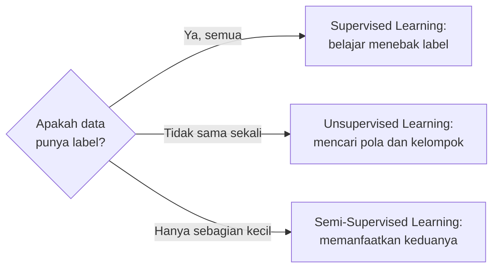

# Labeled Data dan Unlabeled Data

Perbedaan paling penting antar jenis Machine Learning adalah **ada atau tidaknya label**. Mari kita bangun pemahamannya pelan-pelan.

## Apa itu data?

**Data** adalah catatan tentang sesuatu. Dalam Machine Learning, data biasanya berbentuk **tabel**:

- Setiap **baris** mewakili satu hal yang diamati, misalnya satu rumah, satu pelanggan, atau satu bunga. Baris disebut juga *sample* atau *observation*.
- Setiap **kolom** mewakili satu ciri dari hal itu, misalnya luas rumah atau usia pelanggan.

## Apa itu feature?

**Feature** (fitur) adalah kolom yang menjadi **bahan pertimbangan** atau **masukan** bagi model.

Analogi: saat menebak apakah buah sudah matang, kamu melihat warna, kekerasan, dan aromanya. Warna, kekerasan, dan aroma adalah fitur.

## Apa itu label?

**Label** adalah **jawaban** yang menempel pada setiap baris data. Label menjawab pertanyaan yang ingin kita ajarkan kepada model.

Analogi: pada buah tadi, labelnya adalah "matang" atau "belum matang". Seseorang harus memeriksa dan menuliskan jawaban itu.

## Apa itu target variable?

**Target variable** (variabel target) adalah **nama kolom** yang berisi label, yaitu kolom yang ingin ditebak oleh model. Istilah *label* dan *target* sering dipakai bergantian:

- **Target** biasanya merujuk pada kolomnya, misalnya kolom "harga".
- **Label** biasanya merujuk pada nilai jawabannya, misalnya "Rp850 juta" atau "spam".

## Apa itu labeled data?

**Labeled data** adalah data yang **punya kolom jawaban**.

Contoh: data rumah untuk menebak harga.

| Luas (m²) | Jumlah kamar | Jarak ke pusat kota (km) | **Harga (juta Rp)** |
|---|---|---|---|
| 60 | 2 | 12 | **450** |
| 90 | 3 | 8 | **780** |
| 120 | 4 | 5 | **1.200** |
| 75 | 2 | 15 | **520** |

- **Fitur:** Luas, Jumlah kamar, Jarak ke pusat kota.
- **Target:** Harga.
- **Label:** angka 450, 780, 1.200, dan 520.

## Apa itu unlabeled data?

**Unlabeled data** adalah data yang **tidak punya kolom jawaban**. Hanya ada fitur.

Contoh: data pelanggan toko.

| Usia | Pendapatan (juta Rp/tahun) | Kunjungan per bulan | Rata-rata belanja (ribu Rp) |
|---|---|---|---|
| 22 | 30 | 8 | 120 |
| 45 | 150 | 2 | 900 |
| 23 | 35 | 10 | 100 |
| 50 | 160 | 3 | 850 |

Tidak ada kolom "tipe pelanggan". Tidak ada yang pernah memberi tahu bahwa pelanggan pertama termasuk tipe A. Namun kalau diperhatikan, baris 1 dan 3 mirip, begitu pula baris 2 dan 4. Menemukan kemiripan semacam ini adalah tugas **clustering**.

## Perbedaan fitur dan label dengan contoh sederhana

| Pertanyaan | Fitur (yang diketahui) | Label (yang ingin ditebak) |
|---|---|---|
| Apakah email ini spam? | Isi email, pengirim, jumlah tautan | Spam / bukan spam |
| Berapa harga rumah ini? | Luas, jumlah kamar, lokasi | Harga |
| Apakah pasien berisiko diabetes? | Gula darah, usia, berat badan | Berisiko / tidak |
| Pelanggan mana yang mirip? | Usia, pendapatan, kebiasaan belanja | *(tidak ada label)* |

!!! tip "Cara cepat membedakan"
    Tanyakan: "Kolom mana yang **ingin aku tebak**?" Itulah target. Semua kolom lain yang dipakai untuk menebak adalah fitur. Jika tidak ada kolom yang ingin ditebak, berarti datamu tidak berlabel.

## Bagaimana label memengaruhi proses belajar?

- **Dengan label**, model bisa **dikoreksi**: tebakannya dibandingkan dengan jawaban yang benar, sehingga model tahu seberapa salah dan memperbaikinya.
- **Tanpa label**, tidak ada jawaban untuk dibandingkan. Model hanya bisa mengukur kemiripan antar data.

## Mengapa label sering mahal?

Label biasanya dibuat oleh manusia, dan itu butuh waktu, tenaga, dan keahlian:

- Melabeli ribuan foto rontgen membutuhkan dokter spesialis.
- Melabeli ribuan ulasan produk sebagai positif atau negatif membutuhkan banyak jam kerja.
- Untuk tipe pelanggan, kadang **tidak ada yang tahu** jawaban yang benar sejak awal.

Itulah sebabnya Unsupervised dan Semi-Supervised Learning sangat berguna.

## Inti sub-bab ini

- **Fitur** adalah ciri yang dipakai untuk menebak.
- **Label** adalah jawaban. **Target** adalah kolom yang berisi jawaban itu.
- **Labeled data** punya kolom jawaban. **Unlabeled data** tidak.
- Ada atau tidaknya label menentukan jenis Machine Learning yang bisa dipakai.

Lanjut ke [Supervised Learning](03-supervised-learning.md).
