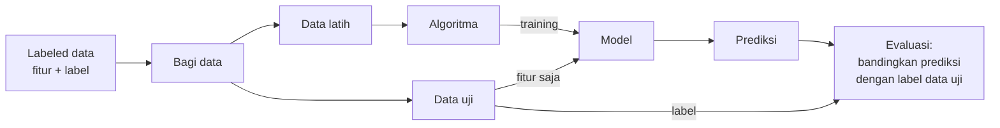

# Supervised Learning

## Definisi sederhana

**Supervised Learning** adalah cara belajar mesin dengan **contoh yang sudah ada jawabannya**. Kata *supervised* berarti "diawasi": seolah ada guru yang selalu memberi tahu jawaban yang benar.

## Penjelasan dengan bahasa sehari-hari

Ingat cara kamu belajar untuk ujian dengan latihan soal yang ada kunci jawabannya. Kamu mengerjakan soal, mencocokkan dengan kunci, lalu memperbaiki pemahaman. Setelah cukup banyak latihan, kamu bisa menjawab soal baru yang belum pernah kamu lihat.

Supervised Learning bekerja persis seperti itu:

- **Soal latihan** = fitur.
- **Kunci jawaban** = label.
- **Ujian dengan soal baru** = prediksi pada data baru.

## Peran labeled data

Tanpa labeled data, Supervised Learning **tidak bisa berjalan**. Label adalah satu-satunya cara model tahu apakah tebakannya benar atau salah.

## Fitur dan target pada Supervised Learning

Secara umum kita menulis:

\[
\hat{y} = f(X)
\]

Cara membacanya: "tebakan \(\hat{y}\) adalah hasil fungsi \(f\) yang diterapkan pada fitur \(X\)."

- \(X\): fitur, biasanya berupa tabel. Huruf besar karena berisi banyak kolom.
- \(y\): target yang sebenarnya, yaitu label.
- \(\hat{y}\) (dibaca "y topi"): tebakan model.
- \(f\): pola yang dipelajari model dari data.

Tujuan belajar adalah membuat \(\hat{y}\) **sedekat mungkin** dengan \(y\).

## Cara kerja Supervised Learning

### 1. Training (pelatihan)

Algoritma melihat data latih: fitur **dan** labelnya. Ia mencari pola yang menghubungkan keduanya. Hasilnya adalah **model**.

### 2. Prediction (prediksi)

Model diberi **fitur saja** dari data yang belum pernah dilihatnya, lalu menghasilkan tebakan label.

### 3. Evaluation (evaluasi)

Tebakan dibandingkan dengan label sebenarnya pada data uji. Karena labelnya ada, kita bisa **menghitung** seberapa sering model benar.

## Contoh lengkap: menebak harga rumah

1. **Kumpulkan data**: 1.000 rumah yang sudah terjual, lengkap dengan luas, jumlah kamar, lokasi, dan **harga jualnya** (label).
2. **Bagi data**: 800 rumah untuk latihan, 200 rumah untuk ujian.
3. **Training**: algoritma mempelajari hubungan antara luas, kamar, lokasi, dan harga pada 800 rumah.
4. **Prediksi**: model diberi luas, kamar, dan lokasi dari 200 rumah ujian, tanpa harganya. Model menebak harganya.
5. **Evaluasi**: tebakan dibandingkan dengan harga sebenarnya. Misalnya rata-rata meleset Rp40 juta.
6. **Pemakaian**: jika hasilnya cukup baik, model dipakai untuk menaksir harga rumah yang baru akan dijual.

## Dua jenis utama Supervised Learning

Jenis Supervised Learning ditentukan oleh **bentuk labelnya**:

| Bentuk label | Jenis | Contoh |
|---|---|---|
| Kategori (pilihan terbatas) | [Classification](04-classification.md) | Spam / bukan spam |
| Angka (nilai kontinu) | [Regression](05-regression.md) | Harga rumah |

## Penerapan di dunia nyata

- Mendeteksi email spam.
- Mendiagnosis penyakit dari hasil laboratorium.
- Menaksir harga rumah atau mobil bekas.
- Memprediksi apakah pelanggan akan berhenti berlangganan.
- Mengenali angka tulisan tangan.

## Kelebihan dan keterbatasan

| Kelebihan | Keterbatasan |
|---|---|
| Tujuannya jelas: menebak label tertentu | Butuh labeled data, yang sering mahal |
| Kinerja mudah diukur karena ada jawaban | Model hanya sebaik label yang diberikan. Label salah, model ikut salah |
| Banyak algoritma yang matang dan teruji | Tidak bisa menemukan kategori baru yang tidak ada di label |
| Hasilnya langsung bisa dipakai untuk keputusan | Bisa "menghafal" data latih dan gagal pada data baru (*overfitting*) |

!!! note "Istilah: overfitting"
    **Overfitting** terjadi ketika model terlalu menyesuaikan diri dengan data latih, termasuk kebetulan-kebetulannya, sehingga gagal pada data baru. Seperti murid yang menghafal kunci jawaban tanpa paham materinya.

## Inti sub-bab ini

Supervised Learning belajar dari **data berlabel** untuk menebak label data baru. Prosesnya: training dengan data latih, prediksi pada data uji, lalu evaluasi dengan membandingkan tebakan dan jawaban sebenarnya.

Lanjut ke [Classification](04-classification.md).
