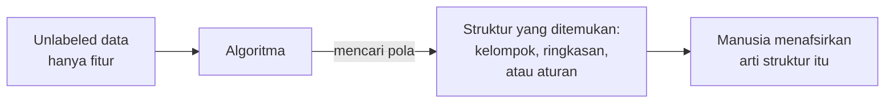

# Unsupervised Learning

## Definisi sederhana

**Unsupervised Learning** adalah cara belajar mesin dengan **data tanpa label**. Tidak ada "guru" dan tidak ada kunci jawaban. Mesin harus menemukan sendiri pola atau struktur di dalam data.

## Penjelasan dengan bahasa sehari-hari

Bayangkan kamu baru pindah ke kota baru dan berjalan-jalan di pasar. Tidak ada yang menjelaskan apa pun. Namun setelah beberapa hari, kamu menyadari sendiri bahwa ada area sayuran, area ikan, area pakaian, dan area elektronik. Kamu menemukan **pengelompokan** dari pengamatan, bukan dari penjelasan orang lain.

## Unlabeled dataset

Data pada Unsupervised Learning hanya berisi fitur:

| Pelanggan | Usia | Pendapatan (juta Rp/tahun) | Kunjungan per bulan |
|---|---|---|---|
| P1 | 22 | 30 | 8 |
| P2 | 45 | 150 | 2 |
| P3 | 23 | 35 | 10 |
| P4 | 50 | 160 | 3 |

Tidak ada kolom jawaban. Model hanya bisa membandingkan baris satu dengan yang lain.

## Cara kerja Unsupervised Learning

Perhatikan langkah terakhir. Algoritma menemukan struktur, tetapi **manusia** yang memberi makna. Algoritma bisa berkata "P1 dan P3 satu kelompok", tetapi tidak tahu bahwa kelompok itu bisa disebut "mahasiswa yang sering berbelanja".

## Apa yang bisa ditemukan?

### Pattern discovery (penemuan pola)

Menemukan keteraturan yang tidak terlihat sekilas. Contoh: barang yang sering dibeli bersamaan.

### Grouping (pengelompokan)

Menyatukan data yang mirip. Ini disebut **clustering**.

### Structure discovery (penemuan struktur)

Menemukan "bentuk" data secara keseluruhan. Contoh: ternyata 50 kolom data survei sebenarnya hanya mengukur 3 hal pokok. Ini terkait **dimensionality reduction**.

## Tiga tugas utama yang dibahas di bab ini

| Tugas | Pertanyaan | Sub-bab |
|---|---|---|
| Clustering | Data mana yang mirip satu sama lain? | [Clustering](07-clustering.md) |
| Dimensionality Reduction | Bagaimana meringkas banyak fitur menjadi sedikit? | [Dimensionality Reduction](08-dimensionality-reduction.md) |
| Association Rule Learning | Item apa yang sering muncul bersama? | [Association Rule Learning](09-association-rule-learning.md) |

## Perbedaan dengan Supervised Learning

| Aspek | Supervised | Unsupervised |
|---|---|---|
| Data | Fitur + label | Fitur saja |
| Tujuan | Menebak label | Menemukan struktur |
| Ada jawaban benar untuk dicocokkan? | Ya | Tidak secara langsung |
| Evaluasi | Membandingkan tebakan dengan label | Memakai ukuran internal dan penilaian manusia |
| Contoh | Spam / bukan spam | Segmen pelanggan |

## Mengapa Unsupervised Learning penting?

1. **Label sering tidak tersedia.** Sebagian besar data di dunia tidak berlabel: log server, transaksi, foto di ponsel, teks di internet.
2. **Label mahal.** Membuat label butuh tenaga ahli dan waktu.
3. **Kadang tidak ada yang tahu jawabannya.** Pemilik toko tidak tahu ada berapa tipe pelanggan. Justru itu yang ingin ditemukan.
4. **Eksplorasi awal.** Sebelum membangun model apa pun, memahami struktur data membantu kita bertanya dengan lebih tepat.

## Penerapan di dunia nyata

- Segmentasi pelanggan untuk pemasaran.
- Pengelompokan dokumen atau berita berdasarkan topik.
- Deteksi transaksi yang tidak biasa.
- Rekomendasi "pelanggan yang membeli ini juga membeli itu".
- Kompresi data dan visualisasi data berdimensi tinggi.

## Kelebihan dan keterbatasan

| Kelebihan | Keterbatasan |
|---|---|
| Tidak butuh label | Hasil lebih sulit dievaluasi karena tidak ada kunci jawaban |
| Bisa menemukan pola yang tidak terduga | Hasil perlu ditafsirkan manusia dan bisa subjektif |
| Bisa memakai data dalam jumlah sangat besar | Hasil sangat dipengaruhi pilihan fitur, skala data, dan parameter |
| Berguna untuk eksplorasi awal | Pola yang ditemukan belum tentu bermakna atau berguna |

!!! note "Unsupervised bukan berarti tanpa evaluasi"
    Walaupun tidak ada label, hasil Unsupervised Learning tetap bisa dan harus dievaluasi, misalnya dengan mengukur seberapa rapat anggota tiap cluster. Ini dibahas mendalam di Level 5: Clustering Evaluation.

## Inti sub-bab ini

Unsupervised Learning mencari struktur dalam **data tanpa label**. Tiga tugas utamanya adalah clustering, dimensionality reduction, dan association rule learning. Hasilnya perlu ditafsirkan oleh manusia.

Lanjut ke [Clustering](07-clustering.md).
