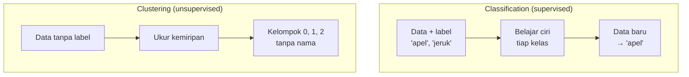

# Clustering

Ini adalah topik utama kurikulum ini. Di sini kita membangun pemahaman awalnya. Detail algoritma akan dibahas di level-level berikutnya.

## Definisi sederhana

**Clustering** adalah tugas Unsupervised Learning untuk **mengelompokkan data yang mirip** ke dalam kelompok yang sama, tanpa label yang diberikan sebelumnya.

## Apa itu cluster?

**Cluster** adalah satu kelompok hasil clustering. Data di dalam satu cluster:

- **mirip** satu sama lain, dan
- **berbeda** dari data di cluster lain.

Analogi: di sebuah pesta, tamu-tamu cenderung berkumpul dalam beberapa gerombolan: teman kantor di satu sudut, teman kuliah di sudut lain, keluarga di dekat meja makan. Setiap gerombolan adalah sebuah cluster. Tidak ada yang mengatur gerombolan itu. Mereka terbentuk karena kemiripan.

## Mengapa clustering tidak butuh label?

Karena tujuannya **menemukan** kelompok, bukan **menebak** kelompok yang sudah diketahui. Kalau kita sudah tahu kelompok tiap data, kita tidak perlu clustering.

Konsekuensinya, algoritma tidak pernah tahu **nama** kelompok. Ia hanya memberi nomor, misalnya cluster 0, 1, dan 2. Manusia yang kemudian menafsirkan, misalnya "cluster 1 berisi pelanggan berpendapatan tinggi tetapi jarang berbelanja".

## Bagaimana algoritma mengukur kemiripan?

Cara paling umum adalah mengukur **jarak**. Dua data dianggap mirip jika jaraknya **dekat**.

Untuk dua fitur, misalnya pendapatan dan skor belanja, setiap pelanggan bisa digambar sebagai titik pada grafik. Jarak lurus antara dua titik disebut **Euclidean distance**:

\[
d(A, B) = \sqrt{(x_A - x_B)^2 + (y_A - y_B)^2}
\]

- \(A\) dan \(B\): dua data, misalnya dua pelanggan.
- \(x_A, y_A\): nilai fitur pertama dan kedua milik \(A\).
- \(x_B, y_B\): nilai fitur pertama dan kedua milik \(B\).
- \(d(A, B)\): jarak antara \(A\) dan \(B\).

Cara membacanya: kurangkan nilai tiap fitur, kuadratkan, jumlahkan, lalu ambil akar kuadratnya. Rumus ini sama dengan teorema Pythagoras yang kamu kenal di sekolah.

**Contoh angka.** Pelanggan dengan (pendapatan, skor belanja):

- \(A = (15, 80)\), \(B = (18, 90)\), \(C = (95, 20)\).

\[
d(A, B) = \sqrt{(15-18)^2 + (80-90)^2} = \sqrt{9 + 100} = \sqrt{109} \approx 10{,}4
\]

\[
d(A, C) = \sqrt{(15-95)^2 + (80-20)^2} = \sqrt{6400 + 3600} = \sqrt{10000} = 100
\]

Jarak \(A\) ke \(B\) hanya sekitar 10,4, sedangkan \(A\) ke \(C\) sejauh 100. Jadi \(A\) lebih mirip dengan \(B\), dan keduanya kemungkinan besar masuk cluster yang sama.

!!! warning "Skala fitur penting"
    Jika satu fitur bernilai jutaan (misalnya pendapatan dalam rupiah) dan fitur lain hanya 1–100, fitur pertama akan mendominasi jarak. Karena itu data perlu disamakan skalanya (*feature scaling*). Topik ini dibahas di Level 2.

## Contoh penerapan

| Penerapan | Data | Kelompok yang ditemukan |
|---|---|---|
| **Customer segmentation** (segmentasi pelanggan) | Usia, pendapatan, frekuensi dan nilai belanja | Misalnya "hemat", "loyal", "belanja besar tetapi jarang" |
| **Document grouping** (pengelompokan dokumen) | Kata-kata dalam artikel | Artikel dengan topik serupa: olahraga, ekonomi, teknologi |
| **Geographic grouping** (pengelompokan wilayah) | Koordinat, curah hujan, kepadatan penduduk | Wilayah dengan karakter serupa, misalnya tingkat kerawanan banjir |

## Algoritma clustering yang umum

| Algoritma | Ide utama | Perlu menentukan jumlah cluster? |
|---|---|---|
| **K-Means** | Menempatkan \(k\) titik pusat, lalu setiap data masuk ke pusat terdekat. Pusat digeser berulang kali sampai stabil | Ya (\(k\)) |
| **Hierarchical Clustering** | Menggabungkan data yang paling dekat sedikit demi sedikit sehingga membentuk "pohon keluarga" kelompok | Tidak harus. Pohon bisa dipotong pada tingkat tertentu |
| **DBSCAN** | Mencari daerah yang padat titik. Titik yang terpencil dianggap *noise* | Tidak. Yang ditentukan adalah ukuran kepadatan |
| **Gaussian Mixture Models (GMM)** | Menganggap data berasal dari campuran beberapa "gundukan" sebaran, lalu menghitung peluang tiap data masuk ke tiap gundukan | Ya |

Semua algoritma ini akan dipelajari satu per satu di Level 4: Clustering Algorithms.

## Clustering bukan classification

Ini kesalahpahaman yang paling sering terjadi. Keduanya sama-sama "memasukkan data ke kelompok", tetapi prosesnya sangat berbeda.

| Aspek | Classification | Clustering |
|---|---|---|
| Jenis | Supervised | Unsupervised |
| Butuh label saat belajar? | Ya | Tidak |
| Daftar kelompok | Sudah ditentukan sebelumnya | Ditemukan dari data |
| Nama kelompok | Sudah ada ("spam") | Hanya nomor. Manusia yang menamai |
| Jumlah kelompok | Pasti, sesuai label | Harus dipilih atau diperkirakan |
| Evaluasi | Bandingkan dengan label | Ukuran internal dan penafsiran |
| Pertanyaan | "Data ini masuk kelas mana?" | "Ada kelompok apa saja di data ini?" |

### Contoh: mengapa berbeda?

Sebuah toko buah punya 300 foto buah.

- **Classification:** seorang karyawan sudah menandai setiap foto: "apel", "jeruk", atau "pisang". Model belajar dari tanda itu. Saat diberi foto baru, model menjawab "apel". Model **tidak mungkin** menjawab "mangga", karena mangga tidak ada di daftar label.
- **Clustering:** tidak ada tanda apa pun. Algoritma mengelompokkan foto berdasarkan warna dan bentuk. Mungkin hasilnya: kelompok merah-bulat, kelompok oranye-bulat, kelompok kuning-panjang. Algoritma **tidak tahu** bahwa itu apel, jeruk, dan pisang. Bahkan mungkin apel hijau masuk ke kelompok yang sama dengan jeruk nipis, karena warnanya mirip.

Contoh terakhir menunjukkan hal penting: clustering mengelompokkan berdasarkan **kemiripan fitur yang diberikan**, bukan berdasarkan "kebenaran" yang ada di kepala manusia.

## Inti sub-bab ini

- Clustering mengelompokkan data yang mirip **tanpa label**.
- Kemiripan biasanya diukur dengan **jarak**, misalnya Euclidean distance.
- Algoritma hanya memberi **nomor** cluster. Manusia yang menafsirkan.
- Clustering **berbeda** dengan classification: tidak ada daftar kelas yang ditentukan sebelumnya.

Lanjut ke [Dimensionality Reduction](08-dimensionality-reduction.md).
