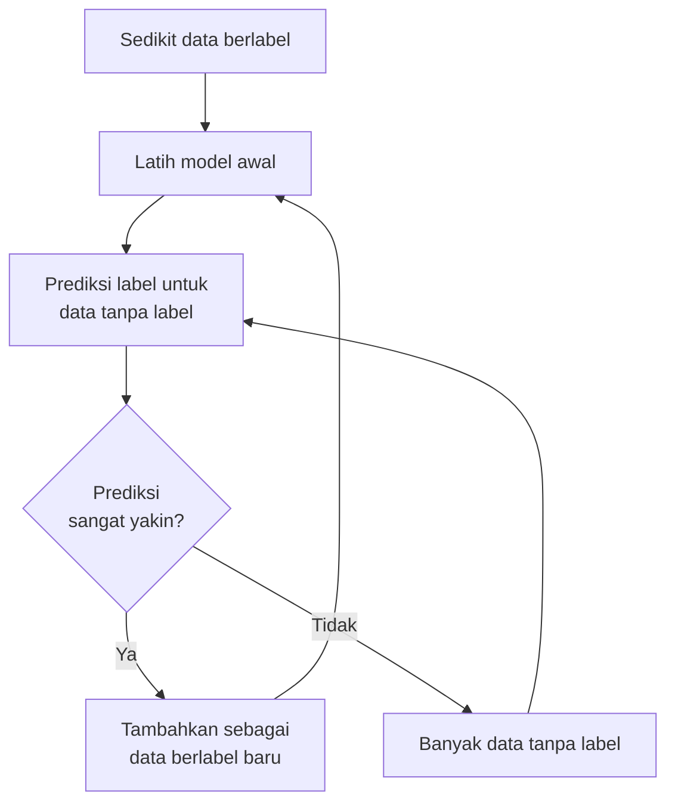

# Semi-Supervised Learning

## Definisi sederhana

**Semi-Supervised Learning** adalah cara belajar mesin yang memakai **sedikit data berlabel** dan **banyak data tanpa label** secara bersamaan. Kata *semi* berarti "setengah" atau "sebagian".

## Penjelasan dengan bahasa sehari-hari

Bayangkan kamu belajar bahasa asing. Gurumu hanya sempat menerjemahkan 20 kalimat. Namun kamu punya buku cerita berisi ribuan kalimat tanpa terjemahan. Dengan berbekal 20 kalimat itu, kamu mulai menebak arti kalimat-kalimat lain di buku cerita, lalu semakin lama semakin paham. Kamu memanfaatkan **sedikit bimbingan** dan **banyak bahan mentah**.

## Mengapa labeled data bisa mahal?

- **Butuh ahli.** Menandai foto rontgen sebagai "normal" atau "pneumonia" membutuhkan dokter.
- **Butuh waktu.** Menandai 100.000 ulasan produk satu per satu memakan ribuan jam kerja.
- **Butuh biaya.** Jasa pelabelan data dibayar per item.

Sementara itu, data **tanpa label** biasanya murah dan melimpah: foto, teks, dan rekaman tersedia dalam jumlah besar.

## Bagaimana cara kerjanya?

Ada beberapa teknik. Salah satu yang paling mudah dipahami adalah **self-training** (melatih diri sendiri):

Langkah-langkahnya:

1. Latih model dengan sedikit data berlabel yang ada.
2. Pakai model itu untuk menebak label data yang belum berlabel.
3. Ambil tebakan yang **paling yakin**, lalu anggap itu sebagai label. Label tebakan ini disebut **pseudo-label** (label semu).
4. Latih ulang model dengan data berlabel yang kini lebih banyak.
5. Ulangi sampai tidak ada lagi tebakan yang cukup yakin.

## Contoh: klasifikasi dokumen

Sebuah portal berita punya 50.000 artikel. Hanya 500 artikel (1%) yang sudah diberi label topik: olahraga, ekonomi, atau teknologi.

- **Supervised biasa** hanya memakai 500 artikel itu, dan 49.500 artikel lainnya terbuang.
- **Semi-supervised** memakai 500 artikel berlabel untuk melatih model awal, lalu memanfaatkan 49.500 artikel lain untuk memperbaiki model. Misalnya, artikel yang banyak memuat kata "gol" dan "liga" dengan yakin diberi label olahraga, lalu ikut dipakai sebagai bahan belajar.

## Penerapan di dunia nyata

- Klasifikasi gambar medis dengan sedikit gambar yang dilabeli dokter.
- Pengenalan ucapan, karena mentranskripsi rekaman suara secara manual sangat mahal.
- Klasifikasi halaman web atau dokumen.
- Deteksi penipuan, ketika hanya sebagian kecil kasus yang sudah dikonfirmasi.

## Kelebihan dan keterbatasan

| Kelebihan | Keterbatasan |
|---|---|
| Menghemat biaya pelabelan | Jika model awal salah, kesalahan bisa **menyebar** karena pseudo-label yang salah ikut dipelajari |
| Memanfaatkan data tanpa label yang melimpah | Tidak selalu lebih baik daripada supervised biasa |
| Sering lebih akurat daripada hanya memakai sedikit data berlabel | Butuh asumsi bahwa data berlabel dan tanpa label berasal dari sebaran yang sama |
| | Lebih rumit untuk diatur dan dievaluasi |

## Perbandingan dengan Supervised dan Unsupervised

| Aspek | Supervised | Semi-Supervised | Unsupervised |
|---|---|---|---|
| Data berlabel | Semua | Sedikit | Tidak ada |
| Data tanpa label | Tidak dipakai | Banyak | Semua |
| Tujuan | Menebak label | Menebak label | Menemukan struktur |
| Biaya pelabelan | Tinggi | Rendah | Tidak ada |

Perhatikan: tujuan Semi-Supervised Learning **sama** dengan Supervised Learning, yaitu menebak label. Bedanya hanya pada cara memanfaatkan data.

!!! info "Di Scikit-learn"
    Scikit-learn menyediakan beberapa alat semi-supervised, misalnya `SelfTrainingClassifier`, `LabelPropagation`, dan `LabelSpreading`. Data tanpa label ditandai dengan nilai label `-1`. Kita tidak memakainya di bab ini.

## Inti sub-bab ini

Semi-Supervised Learning memakai **sedikit label dan banyak data tanpa label**. Tujuannya tetap menebak label, tetapi dengan biaya pelabelan yang lebih rendah. Risikonya: tebakan yang salah bisa ikut dipelajari.

Lanjut ke [Reinforcement Learning](11-reinforcement-learning.md).
