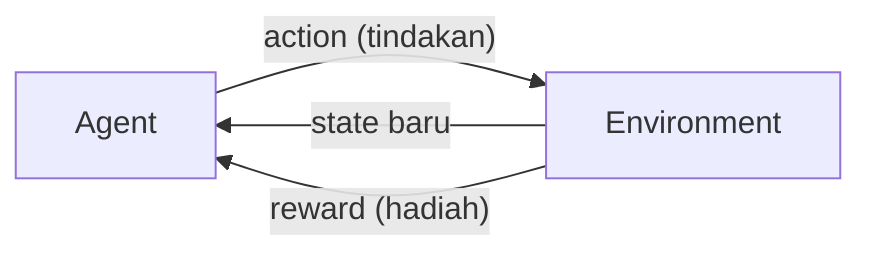

# Reinforcement Learning

## Definisi sederhana

**Reinforcement Learning (RL)** adalah cara belajar mesin dengan **mencoba tindakan**, lalu menerima **hadiah** (*reward*) atau **hukuman** atas tindakan itu. Mesin belajar memilih tindakan yang menghasilkan hadiah sebanyak mungkin dalam jangka panjang.

Kata *reinforcement* berarti "penguatan": tindakan yang menghasilkan hadiah akan diperkuat sehingga lebih sering dilakukan.

## Penjelasan dengan bahasa sehari-hari

Bayangkan melatih anjing untuk duduk. Saat anjing duduk, kamu memberi camilan. Saat ia melompat, ia tidak mendapat apa-apa. Lama-lama anjing paham bahwa duduk menghasilkan camilan. Tidak ada yang menjelaskan kepada anjing apa arti "duduk". Ia belajar dari **akibat** tindakannya.

## Istilah-istilah dasar

Kita pakai satu contoh: **robot kecil di dalam labirin** yang harus menemukan pintu keluar.

**Agent** (agen)
:   Pihak yang belajar dan mengambil keputusan. Pada contoh: **robot**.

**Environment** (lingkungan)
:   Dunia tempat agen berada dan berinteraksi. Pada contoh: **labirin**.

**State** (keadaan)
:   Situasi agen saat ini. Pada contoh: **posisi robot** di dalam labirin.

**Action** (tindakan)
:   Pilihan yang bisa dilakukan agen. Pada contoh: **maju, mundur, belok kiri, belok kanan**.

**Reward** (hadiah)
:   Angka yang diberikan lingkungan setelah agen bertindak. Bisa positif (hadiah) atau negatif (hukuman). Pada contoh: **+100** saat menemukan pintu keluar, **−1** untuk setiap langkah agar robot tidak berputar-putar, **−10** saat menabrak dinding.

**Policy** (kebijakan)
:   "Strategi" agen: aturan untuk memilih tindakan pada setiap keadaan. Pada contoh: "jika di persimpangan A, belok kanan". Tujuan RL adalah menemukan **policy terbaik**.

**Episode**
:   Satu putaran permainan dari awal sampai selesai. Pada contoh: dari robot diletakkan di titik awal sampai menemukan pintu keluar. Agen biasanya belajar dari ribuan episode.

## Interaksi agen dan lingkungan

Langkah demi langkah:

1. Agen **mengamati** state saat ini. Contoh: "aku di persimpangan".
2. Agen **memilih** action berdasarkan policy-nya. Contoh: "belok kanan".
3. Lingkungan **berubah** sebagai akibat tindakan itu, sehingga agen berada di state baru.
4. Lingkungan **memberi reward**. Contoh: −10 karena menabrak dinding.
5. Agen **memperbarui** pengetahuannya: "belok kanan di persimpangan ini buruk".
6. Ulangi dari langkah 1 sampai episode selesai.

## Exploration dan exploitation

Agen selalu menghadapi dilema:

- **Exploitation** (memanfaatkan): memilih tindakan yang **sudah diketahui** memberi hadiah bagus.
- **Exploration** (menjelajah): mencoba tindakan **baru** yang belum pernah dicoba, karena mungkin ada yang lebih baik.

Analogi: kamu punya warung makan langganan yang enak (exploitation). Tetapi kalau tidak pernah mencoba warung baru (exploration), kamu tidak akan tahu bahwa mungkin ada warung yang jauh lebih enak di ujung jalan.

Agen yang baik menyeimbangkan keduanya. Strategi sederhana bernama **ε-greedy** (epsilon-greedy) melakukan exploration secara acak dengan peluang kecil \(\varepsilon\), misalnya 10% waktu, dan exploitation di sisa waktunya.

## Mengenal Q-Learning secara konseptual

**Q-Learning** adalah salah satu algoritma RL klasik. Idenya adalah membuat **tabel nilai** yang disebut **Q-table**.

- Setiap baris adalah sebuah state.
- Setiap kolom adalah sebuah action.
- Setiap sel berisi **nilai Q**: perkiraan seberapa bagus melakukan action tersebut di state tersebut, dengan memperhitungkan hadiah di masa depan.

| State | Maju | Belok kiri | Belok kanan |
|---|---|---|---|
| Persimpangan A | 2,0 | 5,5 | −3,0 |
| Lorong B | 8,1 | 0,0 | 0,0 |

Pada persimpangan A, nilai tertinggi ada di "belok kiri" (5,5), sehingga agen yang sedang exploitation akan memilih belok kiri.

Setiap kali agen bertindak dan menerima reward, nilai Q diperbarui dengan aturan:

\[
Q(s, a) \leftarrow Q(s, a) + \alpha \left[ r + \gamma \max_{a'} Q(s', a') - Q(s, a) \right]
\]

Arti simbolnya:

- \(Q(s, a)\): nilai Q untuk action \(a\) di state \(s\).
- \(\leftarrow\): "diganti dengan nilai baru".
- \(\alpha\) (alfa): *learning rate*, seberapa besar nilai lama diubah. Antara 0 dan 1.
- \(r\): reward yang baru diterima.
- \(\gamma\) (gamma): *discount factor*, seberapa penting hadiah masa depan dibanding hadiah sekarang. Antara 0 dan 1.
- \(s'\): state baru setelah bertindak.
- \(\max_{a'} Q(s', a')\): nilai Q terbaik yang bisa dicapai dari state baru.

**Cara membacanya:** nilai baru = nilai lama + sebagian kecil dari "selisih antara perkiraan yang lebih baik dan perkiraan lama".

**Contoh angka:** \(Q(s,a) = 0\), \(\alpha = 0{,}5\), \(r = 10\), \(\gamma = 0{,}9\), dan nilai Q terbaik di state baru = 4.

\[
Q(s,a) \leftarrow 0 + 0{,}5 \times \left[ 10 + 0{,}9 \times 4 - 0 \right] = 0{,}5 \times 13{,}6 = 6{,}8
\]

**Artinya:** setelah satu pengalaman, agen menaikkan perkiraan nilai tindakan itu dari 0 menjadi 6,8. Setelah ribuan pengalaman, nilai-nilai di Q-table menjadi semakin akurat.

!!! info "Cukup pahami idenya"
    Kamu tidak perlu menghafal rumus ini. Yang penting: Q-Learning **memperbarui perkiraan nilai tindakan sedikit demi sedikit** berdasarkan hadiah yang diterima.

## Contoh di dunia nyata

| Bidang | Agent | Environment | Reward |
|---|---|---|---|
| **Game-playing agents** | Program pemain | Papan permainan atau game | Menang (+), kalah (−) |
| **Robotics** | Robot | Ruangan atau benda yang dipegang | Berhasil mengambil benda (+), menjatuhkannya (−) |
| **Autonomous systems** | Sistem kendali kendaraan atau drone | Jalan atau ruang udara (sering dalam simulasi) | Sampai tujuan dengan aman (+), melanggar batas (−) |
| **Resource optimization** | Pengatur sistem | Pusat data atau jaringan listrik | Hemat energi (+), sistem kelebihan beban (−) |

Contoh terkenal: program AlphaGo dari DeepMind memadukan reinforcement learning dengan deep learning dan pada 2016 mengalahkan pemain Go profesional kelas dunia.

## Perbedaan dengan paradigma lain

| Aspek | Supervised | Unsupervised | Reinforcement |
|---|---|---|---|
| Data awal | Dataset berlabel | Dataset tanpa label | Tidak ada dataset tetap. Data muncul dari interaksi |
| Umpan balik | Jawaban benar untuk setiap contoh | Tidak ada | Reward, sering tertunda |
| Tujuan | Menebak label | Menemukan struktur | Memaksimalkan total reward |
| Keputusan | Satu kali, berdiri sendiri | — | Berurutan dan saling memengaruhi |

Perbedaan kunci dengan Supervised Learning: pada Supervised Learning, model diberi tahu **jawaban yang benar**. Pada RL, agen hanya diberi tahu **seberapa baik** tindakannya, sering kali baru di akhir. Agen tidak pernah diberi tahu tindakan mana yang seharusnya dipilih.

## Inti sub-bab ini

Reinforcement Learning: agen belajar dengan **berinteraksi** dengan lingkungan dan menerima **reward**. Tujuannya menemukan **policy** yang memaksimalkan total reward. Agen harus menyeimbangkan **exploration** dan **exploitation**. Q-Learning adalah algoritma klasik yang mempelajari nilai setiap tindakan.

Lanjut ke [Perbandingan Jenis ML](12-comparison-of-learning-types.md).
