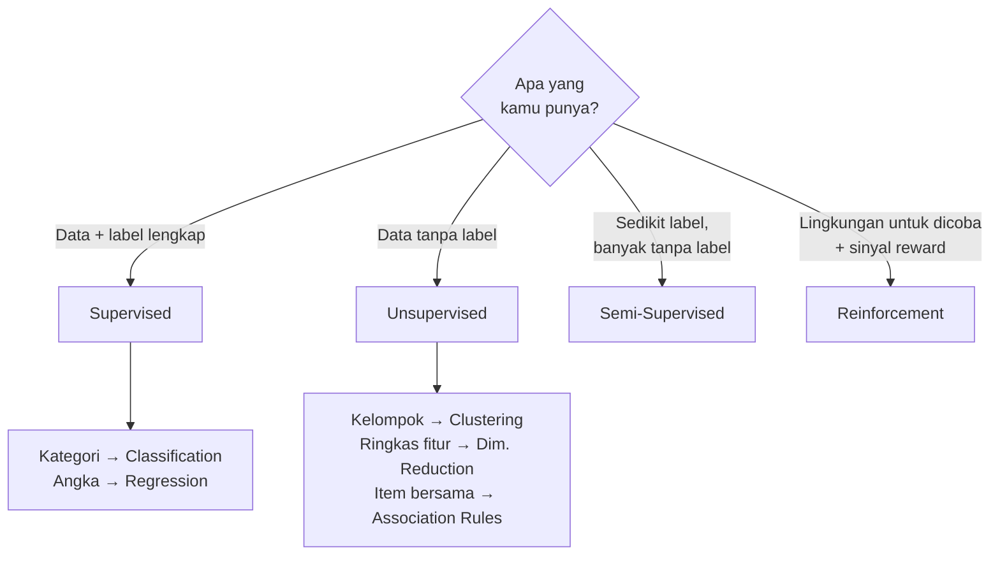

# Perbandingan Jenis Machine Learning

Sub-bab ini merangkum empat paradigma dalam satu tempat agar mudah dibandingkan.

## Tabel perbandingan lengkap

| Aspek | Supervised | Unsupervised | Semi-Supervised | Reinforcement |
|---|---|---|---|---|
| **Tujuan belajar** | Menebak label untuk data baru | Menemukan struktur atau pola tersembunyi | Menebak label dengan sedikit data berlabel | Menemukan tindakan terbaik untuk memaksimalkan reward |
| **Jenis data** | Tabel fitur + label | Tabel fitur saja | Sebagian kecil berlabel, sebagian besar tidak | Pengalaman dari interaksi: state, action, reward |
| **Ketersediaan label** | Semua data berlabel | Tidak ada | Sedikit | Tidak ada label. Yang ada reward |
| **Proses belajar** | Membandingkan tebakan dengan label, lalu memperbaiki diri | Mengukur kemiripan atau sebaran data | Belajar dari label, lalu memanfaatkan data tanpa label | Mencoba, menerima reward, memperbarui strategi |
| **Keluaran** | Kelas atau angka | Nomor cluster, fitur ringkas, atau aturan asosiasi | Kelas atau angka | Policy (strategi bertindak) |
| **Algoritma umum** | Logistic Regression, Decision Tree, KNN, Linear Regression, Random Forest | K-Means, DBSCAN, Hierarchical Clustering, PCA, Apriori | Self-training, Label Propagation | Q-Learning |
| **Contoh penerapan** | Filter spam, taksiran harga rumah | Segmentasi pelanggan, pengelompokan dokumen | Klasifikasi gambar medis dengan sedikit label | Game, robotika, pengaturan energi |
| **Kelebihan** | Tujuan jelas, mudah dievaluasi | Tidak butuh label, bisa menemukan hal baru | Hemat biaya pelabelan | Bisa belajar keputusan berurutan tanpa contoh jawaban |
| **Keterbatasan** | Label mahal, terbatas pada kelas yang ada | Sulit dievaluasi, perlu ditafsirkan manusia | Kesalahan pseudo-label bisa menyebar | Butuh banyak percobaan, sering hanya praktis di simulasi |

## Diagram ringkas

## Pendekatan mana untuk situasi apa?

| Situasi | Pendekatan yang cocok | Alasan |
|---|---|---|
| Ada ribuan contoh lengkap dengan jawaban, ingin menebak jawaban untuk data baru | Supervised | Label tersedia dan tujuannya menebak |
| Ada banyak data, tidak ada jawaban, ingin tahu "ada kelompok apa saja" | Unsupervised (clustering) | Tujuannya menemukan, bukan menebak |
| Data terlalu banyak kolom untuk dianalisis atau digambar | Unsupervised (dimensionality reduction) | Perlu meringkas fitur |
| Ada data struk belanja, ingin tahu barang yang sering dibeli bersama | Unsupervised (association rules) | Mencari pola kemunculan bersama |
| Ada jutaan foto, tetapi hanya ratusan yang sudah dilabeli | Semi-Supervised | Label sedikit dan mahal |
| Sistem harus mengambil keputusan berurutan dan hasilnya baru terlihat belakangan | Reinforcement | Belajar dari reward atas rangkaian tindakan |

## Inti sub-bab ini

Pertanyaan pembeda yang paling penting: **adakah label?** dan **apa yang ingin dihasilkan?** Jawaban atas dua pertanyaan itu biasanya sudah cukup untuk menentukan paradigma.

Lanjut ke [Memilih Pendekatan ML](13-choosing-machine-learning-approach.md).
