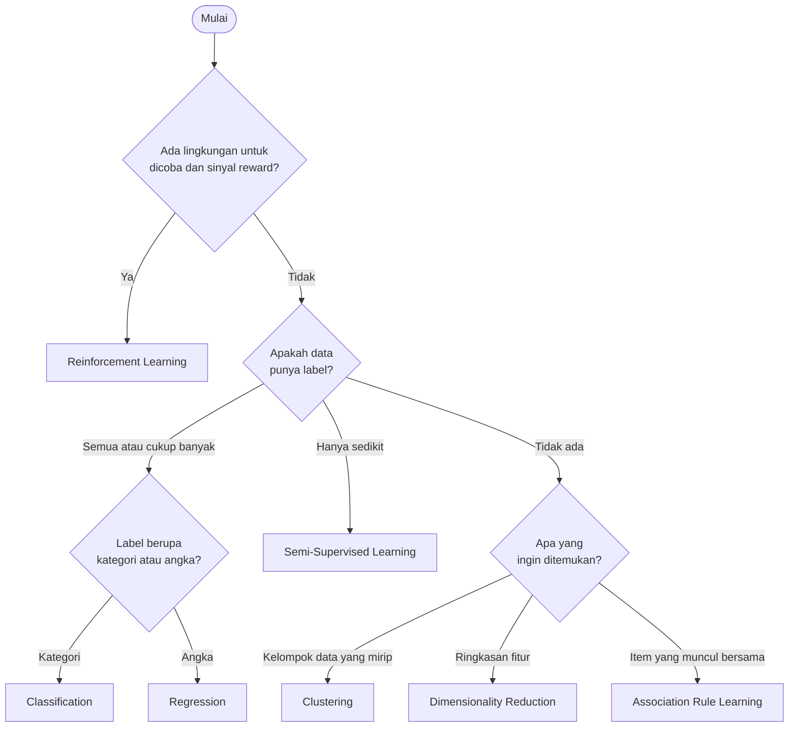

# Memilih Pendekatan Machine Learning yang Tepat

Saat menghadapi masalah nyata, kamu perlu memutuskan pendekatan mana yang dipakai. Sub-bab ini memberi panduan langkah demi langkah.

## Enam pertanyaan panduan

### 1. Apa masalah penelitian atau bisnisnya?

Tuliskan masalahnya dalam satu kalimat. Contoh:

- "Saya ingin tahu apakah sebuah transaksi adalah penipuan." → kemungkinan **menebak**.
- "Saya ingin memahami tipe-tipe pelanggan saya." → kemungkinan **menemukan**.

Kata kerja dalam kalimat itu sering menjadi petunjuk: *menebak, memprediksi, menggolongkan* mengarah ke supervised. *Mengelompokkan, menemukan, memahami struktur* mengarah ke unsupervised.

### 2. Data apa yang tersedia?

- Apakah datanya berupa tabel, teks, gambar, atau log interaksi?
- Berapa banyak? Puluhan, ribuan, atau jutaan baris?
- Apakah ada lingkungan atau simulasi yang bisa dicoba berulang kali?

### 3. Apakah ada label?

- **Semua** data berlabel → Supervised.
- **Sebagian kecil** berlabel → Semi-Supervised, atau Supervised jika labelnya cukup.
- **Tidak ada** label → Unsupervised.
- Tidak ada label, tetapi ada **reward** dari tindakan → Reinforcement.

### 4. Apa keluaran yang diharapkan?

| Keluaran | Tugas |
|---|---|
| Satu kategori dari daftar yang sudah ada | Classification |
| Sebuah angka | Regression |
| Kelompok yang belum diketahui sebelumnya | Clustering |
| Fitur lebih sedikit atau visualisasi 2D | Dimensionality Reduction |
| Aturan "jika A maka B" | Association Rule Learning |
| Strategi atau urutan tindakan | Reinforcement Learning |

### 5. Apa tujuan belajarnya?

- **Prediksi**: hasil dipakai untuk keputusan otomatis, misalnya menolak transaksi.
- **Pemahaman**: hasil dipakai untuk memahami data, misalnya merancang strategi pemasaran. Clustering sering dipakai untuk tujuan ini.

### 6. Bagaimana hasilnya akan dievaluasi?

- Jika ada label untuk diuji, kita bisa menghitung akurasi atau MAE.
- Jika tidak ada label, kita perlu ukuran internal (misalnya kerapatan cluster) dan **penilaian ahli** di bidangnya.
- Pada RL, evaluasinya adalah total reward yang dikumpulkan.

Jika kamu tidak tahu bagaimana mengukur keberhasilan, tujuan masalahnya kemungkinan belum cukup jelas.

## Diagram keputusan

!!! note "Diagram ini adalah panduan, bukan hukum"
    Di dunia nyata, beberapa pendekatan sering **digabungkan**. Misalnya, clustering dipakai dulu untuk menemukan kelompok pelanggan, lalu model classification dilatih untuk memasukkan pelanggan baru ke kelompok yang tepat.

## Skenario dan pembahasannya

### Skenario 1: Prediksi kelulusan mahasiswa

Kampus punya data 5 tahun terakhir: nilai semester, kehadiran, dan **status akhir** (lulus tepat waktu atau tidak). Kampus ingin memperkirakan status mahasiswa yang sedang aktif.

**Pendekatan:** Supervised, Classification (binary).

**Alasan:** ada label historis, dan keluarannya kategori dua pilihan.

### Skenario 2: Segmentasi pelanggan e-commerce

Toko online punya data jutaan pelanggan: frekuensi belanja, nilai belanja, dan kategori produk favorit. Tidak ada yang pernah menentukan "tipe" pelanggan.

**Pendekatan:** Unsupervised, Clustering.

**Alasan:** tidak ada label, dan tujuannya menemukan kelompok yang belum diketahui.

### Skenario 3: Taksiran konsumsi listrik

Perusahaan listrik punya data konsumsi per jam, suhu, dan hari libur selama 3 tahun. Mereka ingin memperkirakan konsumsi besok dalam kWh.

**Pendekatan:** Supervised, Regression.

**Alasan:** ada data historis dengan nilai konsumsi sebenarnya, dan keluarannya angka.

### Skenario 4: Klasifikasi ulasan dengan label terbatas

Sebuah aplikasi punya 200.000 ulasan pengguna. Hanya 1.000 ulasan yang sudah dibaca dan dilabeli "positif" atau "negatif" oleh tim.

**Pendekatan:** Semi-Supervised (atau Supervised dengan 1.000 data saja sebagai pembanding).

**Alasan:** label ada tetapi sangat sedikit dibanding data tanpa label.

### Skenario 5: Pengaturan lampu lalu lintas

Pemerintah kota ingin lampu lalu lintas mengatur durasi hijau secara otomatis agar antrean kendaraan minimal. Tersedia simulator lalu lintas.

**Pendekatan:** Reinforcement Learning.

**Alasan:** keputusan berurutan, tidak ada "jawaban benar" untuk setiap detik, tetapi ada reward yang bisa diukur (panjang antrean), dan ada simulator untuk mencoba.

### Skenario 6: Penataan produk minimarket

Minimarket punya 50.000 struk belanja. Pemilik ingin tahu produk apa yang sebaiknya diletakkan berdekatan.

**Pendekatan:** Unsupervised, Association Rule Learning.

**Alasan:** data berupa transaksi, dan tujuannya menemukan item yang sering dibeli bersama.

### Skenario 7: Visualisasi data survei

Peneliti punya hasil survei dengan 60 pertanyaan dari 2.000 responden, dan ingin melihat apakah responden membentuk kelompok tertentu.

**Pendekatan:** Unsupervised. Dimensionality Reduction (misalnya PCA ke 2 dimensi) untuk visualisasi, dilanjutkan Clustering.

**Alasan:** terlalu banyak fitur untuk digambar langsung, dan tidak ada label.

## Inti sub-bab ini

Gunakan enam pertanyaan: masalah, data, label, keluaran, tujuan, dan evaluasi. Untuk sebagian besar kasus, pertanyaan **label** dan **keluaran** sudah cukup untuk menentukan pendekatan.

Lanjut ke [Praktik Supervised Learning](14-python-supervised-learning.md).
