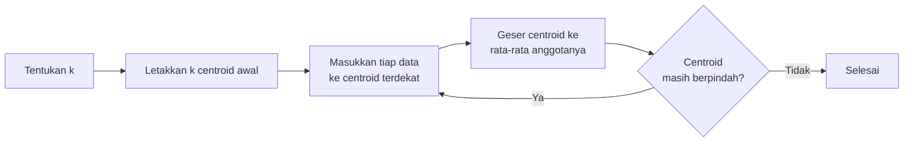

# Praktik Unsupervised Learning: Clustering Pelanggan dengan K-Means

## A. Konteks masalah

Sebuah toko punya data 18 pelanggan: **pendapatan tahunan** dan **skor belanja** (1–100, makin tinggi makin sering dan banyak berbelanja). Pemilik toko ingin tahu: **apakah pelanggan-pelanggan ini membentuk kelompok tertentu?**

Ini masalah **Unsupervised Learning**, tepatnya **clustering**:

- Tidak ada label. Tidak ada yang pernah menandai pelanggan sebagai "tipe A" atau "tipe B".
- Tujuannya **menemukan** kelompok, bukan menebak kelompok yang sudah diketahui.

!!! warning "Ini demonstrasi pengantar"
    Contoh ini sengaja dibuat sederhana: data kecil, buatan, dan kelompoknya jelas. Ini **belum** eksperimen clustering yang lengkap. Pada eksperimen sungguhan kita perlu memeriksa dan membersihkan data, menyamakan skala fitur, memilih jumlah cluster secara sistematis, dan mengevaluasi hasilnya. Semua itu dibahas di level-level berikutnya.

## B. Prasyarat

**Pustaka yang dibutuhkan:**

| Pustaka | Kegunaan |
|---|---|
| `pandas` | Membuat dan mengolah tabel |
| `matplotlib` | Menggambar grafik |
| `scikit-learn` | Algoritma K-Means |

```bash
pip install pandas matplotlib scikit-learn
```

**Data:** kita buat sendiri di dalam kode, sehingga hasilnya selalu sama.

**Konsep yang perlu diingat:** clustering, cluster, dan jarak (lihat [Clustering](07-clustering.md)).

**Mengenal K-Means secara singkat.** K-Means adalah algoritma clustering yang paling populer. Cara kerjanya:

1. Tentukan jumlah cluster, disebut \(k\).
2. Letakkan \(k\) titik pusat (*centroid*) di posisi awal.
3. Masukkan setiap data ke centroid **terdekat**.
4. Pindahkan setiap centroid ke **rata-rata posisi** anggotanya.
5. Ulangi langkah 3 dan 4 sampai centroid tidak lagi berpindah.



## C. Kode lengkap

Simpan sebagai `clustering_pelanggan.py`:

```python title="clustering_pelanggan.py"
# Langkah 1: impor pustaka
import matplotlib.pyplot as plt
import pandas as pd
from sklearn.cluster import KMeans

# Langkah 2: buat dataset TANPA label
pelanggan = pd.DataFrame({
    "pendapatan": [15, 16, 17, 18, 19, 20,      # juta rupiah per tahun
                   55, 57, 60, 62, 58, 61,
                   90, 95, 92, 98, 94, 99],
    "skor_belanja": [80, 85, 78, 90, 82, 88,    # 1-100, makin tinggi makin boros
                     50, 45, 52, 48, 55, 47,
                     15, 20, 12, 18, 10, 22],
})

# Langkah 3: kenali dataset
print(pelanggan.head())
print("Ukuran data:", pelanggan.shape)
print(pelanggan.describe().round(1))

# Langkah 4: siapkan fitur numerik
X = pelanggan[["pendapatan", "skor_belanja"]]

# Langkah 5 dan 6: buat model K-Means dengan 3 cluster
kmeans = KMeans(n_clusters=3, n_init=10, random_state=42)

# Langkah 7 dan 8: latih model sekaligus dapatkan nomor cluster
label_cluster = kmeans.fit_predict(X)
pelanggan["cluster"] = label_cluster
print(pelanggan["cluster"].value_counts().sort_index())

# Pusat tiap cluster (rata-rata posisi anggotanya)
pusat = pd.DataFrame(kmeans.cluster_centers_, columns=X.columns).round(1)
print(pusat)

# Prediksi cluster untuk pelanggan baru
pelanggan_baru = pd.DataFrame({"pendapatan": [58], "skor_belanja": [50]})
print("Pelanggan baru masuk cluster:", kmeans.predict(pelanggan_baru)[0])

# Langkah 9: visualisasi
plt.figure(figsize=(7, 5))
plt.scatter(pelanggan["pendapatan"], pelanggan["skor_belanja"],
            c=pelanggan["cluster"], cmap="viridis", s=60)
plt.scatter(pusat["pendapatan"], pusat["skor_belanja"],
            c="red", marker="X", s=200, label="Pusat cluster")
plt.xlabel("Pendapatan (juta rupiah per tahun)")
plt.ylabel("Skor belanja (1-100)")
plt.title("Hasil K-Means: 3 kelompok pelanggan")
plt.legend()
plt.show()

# Langkah 10: interpretasi dengan rata-rata tiap cluster
print(pelanggan.groupby("cluster")[["pendapatan", "skor_belanja"]].mean().round(1))
```

Jalankan dengan:

```bash
python clustering_pelanggan.py
```

Jendela grafik akan muncul. Tutup jendela itu agar program melanjutkan ke langkah 10.

**Output teks** (grafik muncul di jendela terpisah, lihat Langkah 9 pada bagian D):

```text
   pendapatan  skor_belanja
0          15            80
1          16            85
2          17            78
3          18            90
4          19            82
Ukuran data: (18, 2)
       pendapatan  skor_belanja
count        18.0          18.0
mean         57.0          49.8
std          32.5          28.7
min          15.0          10.0
25%          19.2          20.5
50%          59.0          49.0
75%          91.5          79.5
max          99.0          90.0
cluster
0    6
1    6
2    6
Name: count, dtype: int64
   pendapatan  skor_belanja
0        58.8          49.5
1        94.7          16.2
2        17.5          83.8
Pelanggan baru masuk cluster: 0
         pendapatan  skor_belanja
cluster                          
0              58.8          49.5
1              94.7          16.2
2              17.5          83.8
```

## D. Penjelasan kode langkah demi langkah

### Langkah 1: Mengimpor pustaka

```python
import matplotlib.pyplot as plt
import pandas as pd
from sklearn.cluster import KMeans
```

| Baris | Apa yang diambil | Untuk apa |
|---|---|---|
| `import matplotlib.pyplot as plt` | Modul penggambar grafik, disingkat `plt` | Langkah 9 |
| `import pandas as pd` | Pustaka tabel, disingkat `pd` | Langkah 2 dan seterusnya |
| `from sklearn.cluster import KMeans` | Algoritma K-Means dari modul `cluster` | Langkah 5 |

Perhatikan bahwa kita **tidak** mengimpor `train_test_split` atau `accuracy_score`. Tidak ada label, sehingga tidak ada "jawaban" untuk diuji dengan cara itu.

### Langkah 2: Membuat dataset tanpa label

```python
pelanggan = pd.DataFrame({
    "pendapatan": [15, 16, 17, ...],
    "skor_belanja": [80, 85, 78, ...],
})
```

- `pd.DataFrame({...})` membuat tabel dari sebuah **dictionary**. Setiap kunci (`"pendapatan"`, `"skor_belanja"`) menjadi nama kolom, dan list di belakangnya menjadi isi kolom.
- Ada 18 pelanggan. Kedua list harus sama panjang.
- **Tidak ada kolom label**, misalnya "tipe_pelanggan". Inilah yang membuat masalah ini *unsupervised*.

**Mengapa tidak perlu label?** Kita tidak sedang menebak jawaban yang sudah diketahui. Kita ingin algoritma **menunjukkan** kelompok yang ada. Jika kita sudah tahu tipe tiap pelanggan, kita tidak membutuhkan clustering.

!!! info "Tentang data ini"
    Data ini sengaja dibuat dengan tiga kelompok yang terpisah jelas agar hasilnya mudah dipahami. Data nyata jarang serapi ini.

### Langkah 3: Mengenali dataset

```python
print(pelanggan.head())
print("Ukuran data:", pelanggan.shape)
print(pelanggan.describe().round(1))
```

- `head()` menampilkan 5 baris pertama.
- `shape` menampilkan `(jumlah baris, jumlah kolom)`.
- `describe()` menghitung **statistik ringkas** setiap kolom. `.round(1)` membulatkan hasilnya ke 1 angka di belakang koma.

**Output:**

```text
   pendapatan  skor_belanja
0          15            80
1          16            85
2          17            78
3          18            90
4          19            82
Ukuran data: (18, 2)
       pendapatan  skor_belanja
count        18.0          18.0
mean         57.0          49.8
std          32.5          28.7
min          15.0          10.0
25%          19.2          20.5
50%          59.0          49.0
75%          91.5          79.5
max          99.0          90.0
```

**Interpretasi:**

- 18 pelanggan dan 2 fitur.
- `count`: jumlah data. `mean`: rata-rata. `std`: simpangan baku, yaitu seberapa menyebar data. `min` dan `max`: nilai terkecil dan terbesar. `25%`, `50%`, `75%`: kuartil (nilai pembatas seperempat data).
- Pendapatan berkisar 15–99 dan skor belanja 10–90. Skala keduanya **mirip**, sehingga untuk contoh ini kita tidak perlu menyamakan skala dulu.

### Langkah 4: Menyiapkan fitur numerik

```python
X = pelanggan[["pendapatan", "skor_belanja"]]
```

- Memilih kolom yang akan dipakai untuk mengukur kemiripan. Kurung siku **ganda** menghasilkan tabel (2 dimensi), yang memang diminta oleh Scikit-learn.
- K-Means menghitung **jarak**, sehingga semua fitur **harus berupa angka**. Kolom teks seperti "kota" tidak bisa langsung dipakai.
- Kita menyimpannya di `X` walaupun isinya sama dengan tabel `pelanggan`, karena nanti tabel `pelanggan` akan mendapat kolom baru `cluster`, dan kolom itu **tidak boleh** ikut dipakai sebagai fitur.

### Langkah 5 dan 6: Membuat model dan menentukan jumlah cluster

```python
kmeans = KMeans(n_clusters=3, n_init=10, random_state=42)
```

| Parameter | Nilai | Arti |
|---|---|---|
| `n_clusters` | `3` | Jumlah cluster \(k\). **Kitalah yang menentukan**, bukan algoritma |
| `n_init` | `10` | K-Means dijalankan 10 kali dengan posisi centroid awal yang berbeda, lalu hasil terbaik dipilih. Ini mengurangi risiko hasil buruk karena posisi awal yang kurang beruntung |
| `random_state` | `42` | Mengunci pengacakan posisi awal agar hasil selalu sama |

**Mengapa 3?** Untuk contoh ini kita memilih 3 karena datanya memang dibuat dengan tiga kelompok. Pada data nyata, menentukan jumlah cluster adalah **pertanyaan penting** yang akan dibahas di level evaluasi. **K-Means tidak menentukan jumlah cluster secara otomatis.**

### Langkah 7 dan 8: Melatih model dan mendapatkan nomor cluster

```python
label_cluster = kmeans.fit_predict(X)
pelanggan["cluster"] = label_cluster
print(pelanggan["cluster"].value_counts().sort_index())
```

- `fit_predict(X)` melakukan dua hal sekaligus: **melatih** K-Means pada `X`, lalu **mengembalikan nomor cluster** untuk setiap baris di `X`.
- Perhatikan bahwa kita hanya memberikan `X`, **tanpa `y`**. Bandingkan dengan `model.fit(X_train, y_train)` pada praktik supervised.
- `pelanggan["cluster"] = label_cluster` menambahkan nomor cluster sebagai kolom baru di tabel.
- `value_counts()` menghitung jumlah anggota tiap cluster.

**Output:**

```text
cluster
0    6
1    6
2    6
Name: count, dtype: int64
```

**Interpretasi:** setiap cluster berisi 6 pelanggan.

#### Perbedaan `fit()`, `predict()`, dan `fit_predict()`

| Metode | Apa yang dilakukan | Kapan dipakai |
|---|---|---|
| `fit(X)` | Melatih model: mencari posisi centroid. Tidak mengembalikan nomor cluster | Saat hanya ingin melatih |
| `predict(X_baru)` | Memasukkan data ke centroid terdekat yang **sudah ditemukan**. Tidak mengubah centroid | Untuk data baru setelah model dilatih |
| `fit_predict(X)` | `fit(X)` lalu langsung mengembalikan nomor cluster untuk `X` yang sama | Cara singkat saat ingin melatih dan langsung melihat hasil kelompok |

Kita juga melihat posisi pusat cluster dan memprediksi pelanggan baru:

```python
pusat = pd.DataFrame(kmeans.cluster_centers_, columns=X.columns).round(1)
print(pusat)

pelanggan_baru = pd.DataFrame({"pendapatan": [58], "skor_belanja": [50]})
print("Pelanggan baru masuk cluster:", kmeans.predict(pelanggan_baru)[0])
```

- `kmeans.cluster_centers_` berisi koordinat centroid hasil pelatihan. Garis bawah di akhir nama atribut adalah kebiasaan Scikit-learn untuk menandai nilai yang **baru ada setelah `fit`**.
- `kmeans.predict(...)` memasukkan pelanggan baru ke cluster dengan centroid terdekat.

**Output:**

```text
   pendapatan  skor_belanja
0        58.8          49.5
1        94.7          16.2
2        17.5          83.8
Pelanggan baru masuk cluster: 0
```

**Interpretasi:** pelanggan baru dengan pendapatan 58 dan skor belanja 50 paling dekat dengan centroid cluster 0 (58,8; 49,5).

### Langkah 9: Visualisasi

```python
plt.figure(figsize=(7, 5))
plt.scatter(pelanggan["pendapatan"], pelanggan["skor_belanja"],
            c=pelanggan["cluster"], cmap="viridis", s=60)
plt.scatter(pusat["pendapatan"], pusat["skor_belanja"],
            c="red", marker="X", s=200, label="Pusat cluster")
plt.xlabel("Pendapatan (juta rupiah per tahun)")
plt.ylabel("Skor belanja (1-100)")
plt.title("Hasil K-Means: 3 kelompok pelanggan")
plt.legend()
plt.show()
```

| Baris | Arti |
|---|---|
| `plt.figure(figsize=(7, 5))` | Menyiapkan kanvas berukuran 7 × 5 inci |
| `plt.scatter(x, y, ...)` | Menggambar titik. Sumbu x = pendapatan, sumbu y = skor belanja |
| `c=pelanggan["cluster"]` | Warna titik ditentukan oleh nomor cluster |
| `cmap="viridis"` | Palet warna yang dipakai |
| `s=60` | Ukuran titik |
| `marker="X"`, `s=200`, `c="red"` | Centroid digambar sebagai tanda X merah besar |
| `label="Pusat cluster"` | Teks untuk legenda |
| `xlabel`, `ylabel`, `title` | Keterangan sumbu dan judul |
| `plt.legend()` | Menampilkan legenda |
| `plt.show()` | Menampilkan grafik |

**Output (grafik):**


### Langkah 10: Menafsirkan kelompok

```python
print(pelanggan.groupby("cluster")[["pendapatan", "skor_belanja"]].mean().round(1))
```

- `groupby("cluster")` mengelompokkan baris berdasarkan nomor cluster.
- `.mean()` menghitung rata-rata setiap fitur di dalam tiap cluster.

**Output:**

```text
         pendapatan  skor_belanja
cluster                          
0              58.8          49.5
1              94.7          16.2
2              17.5          83.8
```

## E. Ringkasan output yang diharapkan

Output teks lengkap program ditampilkan langsung di bawah kode pada bagian [C. Kode lengkap](#c-kode-lengkap). Output tiap langkah, termasuk grafik, juga ada tepat di bawah kodenya masing-masing pada bagian D.

Output ini dihasilkan dengan Python 3.14, pandas 3.1.1, matplotlib 3.11.2, dan scikit-learn 1.9.1.

!!! note "Nomor cluster bisa tertukar"
    Nomor 0, 1, 2 tidak punya makna urutan. Pada versi Scikit-learn yang berbeda, kelompok yang sama bisa mendapat nomor yang berbeda, misalnya "pendapatan tinggi" menjadi cluster 2, bukan 1. Yang penting adalah **isi** kelompoknya, bukan nomornya.

## F. Interpretasi hasil

K-Means hanya memberi nomor. Kitalah yang memberi makna dengan melihat rata-rata tiap cluster:

| Cluster | Rata-rata pendapatan | Rata-rata skor belanja | Tafsiran (oleh manusia) |
|---|---|---|---|
| 2 | 17,5 | 83,8 | Pendapatan rendah tetapi sangat aktif berbelanja |
| 0 | 58,8 | 49,5 | Pendapatan dan aktivitas belanja menengah |
| 1 | 94,7 | 16,2 | Pendapatan tinggi tetapi jarang berbelanja |

Dari sini pemilik toko bisa berpikir strategis. Misalnya, cluster 1 punya daya beli tinggi tetapi jarang berbelanja. Mungkin mereka perlu penawaran produk premium.

Bandingkan dengan praktik supervised: di sana kita bisa menghitung **akurasi** karena ada jawaban. Di sini tidak ada jawaban untuk dicocokkan. Kualitas clustering dinilai dengan cara lain, yang akan dipelajari di Level 5.

## G. Kesalahan umum pemula

| Kesalahan | Akibat | Solusi |
|---|---|---|
| Memasukkan kolom teks ke `X` | `ValueError: could not convert string to float` | Pakai hanya kolom angka. Kolom kategori perlu diubah dulu (dibahas di Level 2) |
| Ikut memasukkan kolom `cluster` ke `X` saat menjalankan ulang | Hasil menjadi aneh karena nomor cluster dianggap fitur | Pilih kolom fitur secara eksplisit, seperti di langkah 4 |
| Menganggap nomor cluster punya urutan, misalnya "cluster 2 lebih baik dari cluster 1" | Tafsiran keliru | Nomor hanyalah nama. Tafsirkan dari isi kelompok |
| Mengira K-Means memilih jumlah cluster sendiri | Hasil dipercaya tanpa diperiksa | `n_clusters` selalu ditentukan oleh kita |
| Fitur dengan skala sangat berbeda, misalnya pendapatan dalam rupiah penuh dan skor 1–100 | Satu fitur mendominasi jarak | Samakan skala fitur (dibahas di Level 2) |
| Grafik tidak muncul | `plt.show()` tidak dipanggil, atau program dijalankan di server tanpa layar | Pastikan `plt.show()` ada. Di Jupyter Notebook grafik muncul otomatis |
| Peringatan tentang `n_init` di versi Scikit-learn lama | Hanya peringatan, program tetap jalan | Tulis `n_init=10` secara eksplisit, seperti di contoh |

## H. Latihan mini

1. Ubah `n_clusters=3` menjadi `n_clusters=2`. Kelompok mana yang digabung? Apakah hasilnya masih masuk akal?
2. Tambahkan pelanggan baru `{"pendapatan": [20], "skor_belanja": [85]}` dan prediksi cluster-nya dengan `kmeans.predict`.
3. Ganti `fit_predict(X)` dengan `fit(X)` diikuti `predict(X)`. Apakah hasilnya sama?

Lanjut ke [Miskonsepsi Umum](16-common-misconceptions.md).
